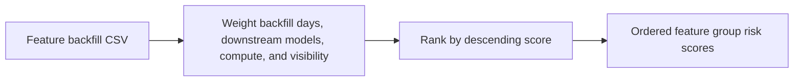

# Feature Backfill Impact Planner

Ranks ML feature backfills by customer impact, compute pressure, and downstream dependency count.

Focus: feature platform, Spark backfills, operational risk, SRE prioritization.

Portfolio framing: Apple-scale client-style AI/ML platform project using synthetic data only.

## Run

```bash
python3 backfill_planner.py sample_backfills.csv
```

## Verify

```bash
python3 -m unittest discover . -v
```

## Local verification

Run `make verify` with Make and Python 3 installed. The target runs the documented sample through the project CLI. It also runs the existing Python unit tests.

## Business problem

Feature backfills compete for compute. Operators need to compare downstream dependency and customer impact before choosing an order.

## Project walkthrough



[Architecture and data flow](docs/ARCHITECTURE.md) · [Business problem, demo, and verification](docs/CASE_STUDY.md)
