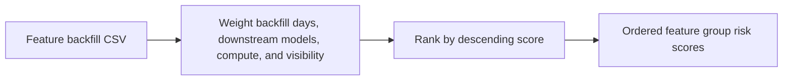

# Feature Backfill Impact Planner architecture

Ranks ML feature backfills by customer impact, compute pressure, and downstream dependency count.

## Operational boundaries

The documented run evaluates the bundled sample locally. Results depend on the quality and scope of the input. The demo makes no live infrastructure changes.
